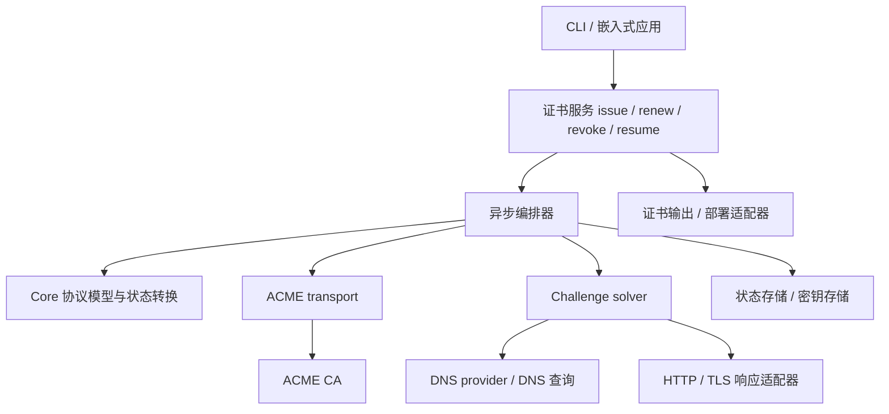

# AsterACME 架构设计

状态：设计基线，尚未实现。日期：2026-11-10。

规范依据见 [ACME RFC 参考](rfc-reference.md)。本文确定职责、依赖方向与可靠性契约；Rust 代码均为接口示意，不承诺最终签名。

## 1. 目标与边界

AsterACME 提供可嵌入的 Rust 库和 CLI，管理 ACME 账户、证书申请、续期与吊销。调用者声明域名及验证策略，库内部承担协议推进、challenge 准备、轮询、恢复和清理。

首期面向 DNS 标识符，包括 SAN 与通配符；实现 DNS-01、HTTP-01，并在续期设计中支持 ARI。TLS-ALPN-01 预留 solver 接口，其他标识符和草案扩展按明确需求加入。依赖成熟密码学、CSR 和 X.509 库，不自行实现底层密码算法。

分层是职责边界，不要求每个接口都单独形成 crate。初期不建设通用工作流引擎、全局插件注册表或完整的 Effect 解释器。

## 2. 总体结构



依赖由外向内。Core 不依赖 HTTP 客户端、DNS provider、文件系统、CLI 或 Tokio；网络与持久化副作用由编排器通过显式注入的接口执行。

### Crate 所有权

| Crate | 负责 | 不负责 |
| --- | --- | --- |
| `aster-acme-core` | 协议资源、标识符、错误模型、状态及转换规则、签名输入和 challenge 材料计算 | 网络、磁盘、供应商凭据、调度 |
| `aster-acme` | 公共高层 API、异步编排、ACME transport、solver/存储/密钥接口、续期策略 | DNS 供应商实现、命令解析 |
| `aster-acme-dns` | DNS-01 solver、zone 路由、委托解析、传播检查、provider 适配 | ACME 订单推进、证书部署 |
| `aster-acme-cli` | 参数与配置、文件存储适配、进度显示、证书输出、部署 hook、退出码 | 协议状态机、challenge 重试与清理算法 |

`aster-acme-dns` 依赖 `aster-acme` 的 solver 契约；`aster-acme` 不反向依赖 DNS 实现，由应用注入 solver。HTTP-01 和后续 TLS-ALPN-01 可先作为 `aster-acme` 内模块，存在独立依赖或复用需求后再拆分。

## 3. Core：资源状态机与客户端流程分离

ACME 不是一个线性订单 enum。账户、订单、授权和 challenge 是不同资源，各有服务端状态；一次 SAN 申请可以包含多个授权，也可能复用已有效的授权。

| 模型 | 代表状态 |
| --- | --- |
| 账户 | valid / deactivated / revoked |
| 订单 | pending / ready / processing / valid / invalid |
| 授权 | pending / valid / invalid / deactivated / expired / revoked |
| Challenge | pending / processing / valid / invalid |

Core 用穷尽匹配表达已知状态，并保留未知 wire 值用于兼容和诊断；未知状态不能被当成成功。分别检查各资源的合法操作，不靠一个全局 enum 假装协议只有一条路径。

客户端流程另外保存本地阶段：

```text
准备账户 → 创建或恢复订单 → 满足各个授权 → 等待订单 ready
    → 提交 CSR → 等待签发 → 下载并检查证书 → 保存签发结果
```

challenge 清理具有独立状态，可与其他授权推进交错；部署也独立于签发。订单 valid 不表示证书已下载、输出成功或部署成功。

Core 提供可确定性测试的解析、材料计算和转换判断。编排器取得服务端响应后更新快照，调用 Core 决定合法的下一步。不同轮询间可能跳过中间状态，因此不能只接受逐级观察到的转换。

## 4. 公共 API 与配置边界

客户端构造时注入 CA directory、账户选择、密钥与状态存储、solver、时钟及执行策略。单次请求只表达证书需求。

```rust
// 示意：配置、凭据及适配器已通过 builder 注入。
let result = client.issue(IssueRequest {
    identifiers: vec![
        Identifier::dns("example.com")?,
        Identifier::dns("*.example.com")?,
    ],
    challenge: ChallengePolicy::Require(ChallengeKind::Dns01),
    key: CertificateKeyPolicy::Generate(KeyAlgorithm::EcdsaP256),
}).await?;
```

公共操作包括 `issue`、`renew`、`revoke` 和按持久化 operation ID 执行的 `resume`。操作进度通过事件/观察接口输出，不依赖终端或全局 logger。

- `IssueRequest` 包含标识符、验证策略和证书密钥选择；生成 CSR 所用密钥必须可恢复，不能重启后静默换钥。
- 自带 CSR 是独立输入形式，与“库生成密钥和 CSR”互斥；校验 CSR 与请求标识符匹配。
- 证书请求选择 DNS-01；客户端配置将域名路由到 DNS provider 和凭据引用。这两个维度分开。
- `Require` 不允许静默回退；`Prefer` 仅在配置明确允许且服务端提供候选 challenge 时选择其他方法。失败不自动触发新订单或无限回退。
- 通配符根据协议与 CA 能力选择验证方式；不将 DNS-01 配置套用于 IP 标识符。
- 返回值携带 operation ID、证书链、密钥引用和清理状态；私钥不进入通用进度事件或 Debug 输出。

账户创建涉及条款接受、联系信息和可选 EAB；这些由显式配置提供。不得默认替用户接受新条款。

## 5. Challenge solver 生命周期

统一生命周期：

```text
记录准备意图 → prepare → 持久化准备结果 → wait_ready
    → 编排器通知 CA → 编排器轮询授权 → cleanup
```

通知 CA 与解释授权结果由编排器负责。Solver 不持有 ACME 账户，不自行推进订单。

```rust
// 示意：具体异步 trait 写法在实现时确定。
trait ChallengeSolver {
    async fn prepare(&self, input: &ChallengeInput,
                     operation: &OperationContext) -> Result<PreparedChallenge>;
    async fn wait_ready(&self, prepared: &PreparedChallenge,
                        context: &ExecutionContext) -> Result<()>;
    async fn cleanup(&self, prepared: &PreparedChallenge,
                     context: &ExecutionContext) -> Result<()>;
}
```

`ChallengeInput` 是按方法区分的类型化材料：DNS 的 FQDN/TXT 值、HTTP 的 token/key authorization、TLS 的证书材料等。`PreparedChallenge` 包含 solver 类型、配置引用、schema 版本及可持久化资源句柄；provider 专用句柄使用带类型与版本的载荷，不使用不可恢复的进程内指针。恢复时需能根据配置引用重新构造 solver；其中不嵌入原始凭据。

清理必须可重试；资源已不存在视为清理完成。Drop 不承担异步清理保证。取消、超时、验证失败和进程重启均需保留待清理记录。验证处理尚未结束时，不仅因本地超时就立即撤掉材料；恢复流程先对账远端状态，必要时等待或显式终止授权，再执行清理。

### DNS-01

- 优先复用 `dns-orchestrator-provider`，由适配器隔离其类型和错误，避免其公共类型成为整个库的 API 契约。
- 使用最长匹配的显式 zone/provider 路由；自动发现需处理分页与真实 zone 边界。
- CNAME/NS 委托限定在配置授权范围，并限制追踪深度、检测循环。
- 同一名称多个 TXT 值必须共存；裸域名与通配符授权可能共享名称。
- 保存 provider、zone、record ID、名称和值，以及 created/borrowed 所有权。仅删除自建记录；不得覆盖或清空共享 RRset。
- 同一记录被多个本地操作使用时，需要协调租约；无法保证跨进程共享安全时，明确限制单写者，不能假定内存锁覆盖其他进程。
- `wait_ready` 检查预期 TXT 值，支持权威查询及配置的递归观测；处理 TXT 分段、负缓存、超时及取消。传播检查不保证 CA 一定验证成功。

### HTTP-01 与 TLS-ALPN-01

Solver 依赖响应发布接口，既可对接应用内 responder，也可对接独立监听器或受控 Web root。HTTP token 路径必须校验且不能允许路径穿越；不要求每次申请都启动独占 80 端口的服务器。

TLS-ALPN-01 通过独立适配器提供验证证书和 ALPN 响应；普通业务证书部署和验证证书生命周期分开。同一标识符的并发 challenge 由 responder 能力和锁策略约束。

## 6. ACME transport 与密码学

Transport 负责 directory、HTTPS、响应解析、nonce 管理、JWS 封装、POST-as-GET、Retry-After 和 ACME problem 映射。Core 定义协议语义及签名输入，密钥接口完成签名；密码学实现来自成熟库。

- nonce 并发安全地消费，badNonce 后按有界策略重新构建并签名请求；不重放原始 JWS。
- 严格区分 POST-as-GET 空 payload、JSON 空对象和 challenge 响应。
- 账户 JWK/kid、账户密钥轮换的嵌套签名与 EAB 有独立覆盖；不把所有签名请求混成一个无约束 JSON 接口。
- 网络超时不证明服务端没有执行操作。新建账户、创建订单和 finalize 的恢复要结合已知资源查询与对账，不提供虚假的 exactly-once 承诺。
- EAB 密钥、私钥及供应商 token 不写入日志；错误保留安全的类型、状态码和问题详情。
- 默认验证 TLS，测试环境的信任配置显式注入；生产不提供隐式降级。

## 7. 持久化、并发与恢复

存储接口区分账户元数据、密钥材料和申请操作。至少保存：

| 数据 | 关键内容 |
| --- | --- |
| 账户 | directory URL、账户 URL、账户密钥引用、条款相关配置 |
| 操作 | operation ID、schema 版本、请求摘要、订单/授权/challenge URL、本地阶段、期限及错误 |
| Challenge | 准备意图、solver 配置引用、资源句柄、所有权、清理阶段 |
| 签发 | CSR、证书密钥引用、证书及链、有效期、ARI/下次调度信息 |
| 部署 | 输出版本、部署状态、hook 结果；与签发状态分离 |

外部副作用前先保存意图，成功后保存结果。DNS API 创建成功与本地写盘之间仍有崩溃窗口；恢复必须通过精确名称/值与 provider 记录查询对账。无法证明所有权的记录不能自动删除，留下明确的恢复诊断，不以猜测清理他人记录。

恢复先查询已知远端资源，再决定继续等待、准备缺失材料、下载证书或清理；不直接从旧本地阶段盲目重放。授权已 valid 时可跳过准备；订单已 valid 时优先取回证书。失效订单显式结束，创建替代订单遵循有界策略并记录关联。

存储提供版本检查或事务更新，单操作只有一个执行者。CLI 文件后端使用进程间锁及原子替换；嵌入式应用可注入数据库实现。凭据缺失、句柄版本未知或锁冲突都应返回可诊断结果。

网络请求、单 challenge、整体申请与清理分别有期限；并发数按订单、provider 和 CA 限制。取消令牌传递到所有 I/O；调用方放弃 future 不能被当成清理成功。

## 8. 签发、输出与部署

下载后检查证书可解析、公钥与 CSR/密钥一致、标识符符合请求、证书链结构与有效期合理；这不等价于对所有平台作公开信任保证。证书链选择遵循 CA 提供的可用链及明确策略。

签发成功后先持久化证书结果。输出适配器将证书、链和私钥作为一组版本化产物发布；仅对单个文件原子 rename 不足以保证整组一致。可采用版本目录加原子切换引用，密钥文件使用受限权限。

部署 hook 在发布后执行，失败标记为部署失败，可单独重试；不得因此重新签发。默认以程序与参数数组执行，shell 模式需显式配置；限制执行时长，不在日志暴露凭据。

清理失败不抹去已签发结果：返回证书可用及 cleanup pending 的结构化状态，并保留重试任务。CLI 明确报告未完成清理，不能只输出“成功”。

## 9. 续期与调度

`renew` 复用申请服务及 solver，保留证书记录与替换关系。ARI 可用时读取建议窗口，在窗口内分散调度并持久化所选时间；遵守服务端刷新提示。ARI 不可用或查询失败时，使用基于证书有效期的明确回退策略，并确保调度早于过期。

CLI 初期提供可由 systemd timer/cron 调用的单次续期检查，库暴露下次执行时间；不强迫嵌入式应用运行内置守护进程。调度器注入时钟和随机源，以便测试；重启不应重新随机出一个持续后移的续期时间。

## 10. 错误与可观测性

错误按配置、协议、CA problem、transport、solver、存储、密钥、输出和部署分类。是否可重试由错误和当前操作语义共同决定，不能仅凭 HTTP 5xx 或一个布尔标志无限重试。

事件携带 operation ID、阶段、授权标识、尝试次数、下次轮询时间及脱敏错误。资源 URL 和域名也可能涉及隐私，日志级别与导出策略允许调用方控制；禁止输出私钥、token、EAB 密钥和完整签名请求。

## 11. 验证策略与实现顺序

| 层 | 验证重点 |
| --- | --- |
| Core | 资源状态转换、跳跃观察、未知状态、JWK thumbprint、challenge 材料与规范向量 |
| Transport | mock CA 验证 JWS、nonce 并发、badNonce、POST-as-GET、Retry-After、problem、超时不确定性 |
| 编排 | 虚拟时钟、多个授权、部分失败、有效授权复用、取消、恢复、重试上限 |
| Solver | TXT 多值和共享所有权、委托、传播超时、prepare 崩溃窗口、清理幂等 |
| 存储/输出 | schema 版本、并发锁、原子发布、私钥权限、部署失败后重试 |
| 集成 | Pebble 申请/续期/吊销、进程重启；真实 CA staging 与受控 DNS 单独验证 |

实现按完整可验证链路推进：Core 与 transport → 账户与单域名 HTTP-01 签发 → 持久化恢复和 DNS-01 → SAN/通配符与并发清理 → ARI、输出和部署 → CLI 完整路径。EAB、轮换和吊销在各自协议能力交付时补齐。测试覆盖与实现同步，不等 CLI 完成后才验证协议。

## 12. 依赖与工程约束

采用 Tokio、reqwest + rustls、Serde/serde_json、tracing、clap、toml 和 Hickory。reqwest 关闭默认 feature，仅启用 rustls 与 JSON；不默认开启 HTTP/2、系统代理、压缩和 cookies。TLS 使用稳定 rustls 0.23 系列，与 reqwest 的后端保持一致，不采用 0.24 开发版。

根 `Cargo.toml` 的 `[workspace.dependencies]` 是所有依赖版本和 feature 策略的唯一事实源。成员 crate 的普通、开发、构建及 target 专用依赖都必须使用 `workspace = true`，不得自行声明 version、path、git 或额外 feature；新增能力先修改根配置。依赖仅在实际使用时由成员领取，根表中的预选依赖不代表已编译或已验证集成。提交 Cargo.lock 固定 CLI 的完整解析结果。

Core 保持无网络和运行时依赖。其他基础组件包括 thiserror、url、time、base64、sha2 和 zeroize。CSR/X.509、账户签名、文件锁与取消组件在实现相关能力时核对后端及平台兼容性，再加入根配置；不预先引入数据库或通用 JWT 框架。

所有成员继承 workspace lint。Clippy 与 AsterForge 对齐：启用 pedantic，禁止无说明或不可追踪的 allow、可能截断及丢失符号的转换，并检查 unsafe 块。需要有依据的局部抑制时使用带 reason 的 expect。AsterACME 额外禁止自身代码使用 unsafe；CI 使用 `-D warnings` 将警告作为失败。

每个 crate 的入口文件先放置 `//!` 单行文档注释，再放置 lint 属性。入口文件使用 `cfg_attr(not(test), deny(...))`，在非测试代码中禁止 `unwrap_used`、`unreachable`、`expect_used`、`panic`、`unimplemented` 和 `todo`。新增库或二进制入口也必须添加；测试代码不受这组六项限制，仍遵守 workspace lint。

DNSO 不作为 crate 依赖。按需迁入 provider 源码，保留原 MIT 版权与许可声明，重新核验 API 签名、分页、TXT 多值、错误与重试语义，并适配统一 reqwest 客户端。原项目不作为维护和正确性的保证。

当前骨架使用 stable Rust channel、edition 2024，manifest 的最低版本暂设 1.99，成员暂不发布；MSRV 尚未作跨版本验证。CLI 仅提供帮助和版本信息，普通执行明确返回未实现错误。
