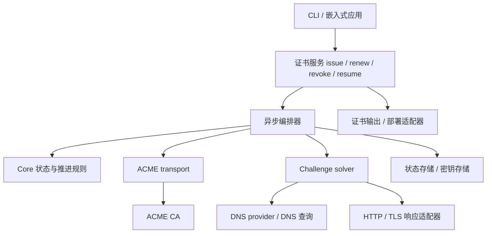

# AsterACME 架构设计

状态：架构基线；账户与手动 DNS-01 签发、持久化恢复及只读订单查看已实现；ARI 续期计划及账户签名吊销也已实现；自动 DNS provider、自动续期、daemon 和部署仍为设计目标。日期：2026-11-11。

规范依据见 [ACME RFC 参考](rfc-reference.md)。本文确定职责、依赖方向与可靠性契约；Rust 代码均为接口示意，不承诺最终签名。

## 1. 目标与边界

AsterACME 提供可嵌入的 Rust 库和 CLI，管理 ACME 账户、证书申请、续期与吊销。调用者声明域名及验证策略，库内部承担协议推进、challenge 准备、轮询、恢复和清理。

首期面向 DNS 标识符，包括 SAN 与通配符；实现 DNS-01、HTTP-01，并在续期设计中支持 ARI。TLS-ALPN-01 预留 solver 接口，其他标识符和草案扩展按明确需求加入。依赖成熟密码学、CSR 和 X.509 库，不自行实现底层密码算法。

分层是职责边界，不要求每个接口都单独形成 crate。初期不建设通用工作流引擎、全局插件注册表或完整的 Effect 解释器。

## 2. 总体结构



依赖由外向内。Core 不依赖 HTTP 客户端、DNS provider、文件系统、CLI 或 Tokio；网络与持久化副作用由编排器通过显式注入的接口执行。

### Crate 所有权

| Crate | 负责 | 不负责 |
| --- | --- | --- |
| `aster_acme_core` | 资源状态枚举、本地流程阶段及纯状态推进决策 | 验证方法、材料计算、网络、磁盘、供应商凭据、调度 |
| `aster_acme_protocol` | 线上请求/响应、精确资源 URL、directory 发现模型、problem、JWS/header | HTTP 执行、签名算法、持久化、命令输出 DTO |
| `aster_acme` | 标识符、验证策略与材料、公共高层 API、异步编排、ACME transport、solver/存储/密钥接口、续期策略 | DNS 供应商实现、命令解析 |
| `aster_acme_validation` | DNS-01 solver、zone 路由、委托解析、传播检查、provider 适配 | ACME 订单推进、证书部署 |
| `aster_acme_cli_storage` | CLI 账户元数据、PKCS#8 文件、锁、权限和原子持久化；实现上层 dyn 契约 | 协议、core、DNS 验证及命令解析 |
| `aster_acme_cli` | 参数与配置、适配器组装、进度显示、证书输出、部署 hook、退出码 | 协议状态机、challenge 重试与清理算法 |

`aster_acme_validation` 依赖 `aster_acme` 的 solver 契约；`aster_acme` 不反向依赖 DNS 实现，由应用注入 solver。HTTP-01 和后续 TLS-ALPN-01 可先作为 `aster_acme` 内模块，存在独立依赖或复用需求后再拆分。

## 3. Core：资源状态机与客户端流程分离

ACME 不是一个线性订单 enum。账户、订单、授权和 challenge 是不同资源，各有服务端状态；一次 SAN 申请可以包含多个授权，也可能复用已有效的授权。

| 模型 | 代表状态 |
| --- | --- |
| 账户 | valid / deactivated / revoked |
| 订单 | pending / ready / processing / valid / invalid |
| 授权 | pending / valid / invalid / deactivated / expired / revoked |
| Challenge | pending / processing / valid / invalid |

Core 用穷尽匹配表达已知状态，并保留未知 wire 值用于兼容和诊断；未知状态不能被当成成功。分别检查各资源的合法操作，不靠一个全局 enum 假装协议只有一条路径。

客户端流程另外保存本地阶段：

```text
准备账户 → 创建或恢复订单 → 满足各个授权 → 等待订单 ready
    → 提交 CSR → 等待签发 → 下载并检查证书 → 保存签发结果
```

challenge 清理具有独立状态，可与其他授权推进交错；部署也独立于签发。订单 valid 不表示证书已下载、输出成功或部署成功。

Core 提供可确定性测试的状态解析和推进判断，不理解验证方法、标识符或材料。上层负责这些语义。编排器取得服务端响应后更新快照，调用 Core 决定合法的下一步。不同轮询间可能跳过中间状态，因此不能只接受逐级观察到的转换。

## 4. 公共 API 与配置边界

客户端构造时注入 CA directory、账户选择、密钥与状态存储、solver、时钟及执行策略。单次请求只表达证书需求。

```rust
// 示意：配置、凭据及适配器已通过 builder 注入。
let result = client.issue(IssueRequest {
    identifiers: vec![
        Identifier::dns("example.com")?,
        Identifier::dns("*.example.com")?,
    ],
    challenge: ChallengePolicy::Require(ChallengeKind::Dns01),
    key: CertificateKeyPolicy::Generate(KeyAlgorithm::EcdsaP256),
}).await?;
```

公共操作包括 `issue`、`renew`、`revoke` 和按持久化 operation ID 执行的 `resume`。操作进度通过事件/观察接口输出，不依赖终端或全局 logger。

- `IssueRequest` 包含标识符、验证策略和证书密钥选择；生成 CSR 所用密钥必须可恢复，不能重启后静默换钥。
- 自带 CSR 是独立输入形式，与“库生成密钥和 CSR”互斥；校验 CSR 与请求标识符匹配。
- 证书请求选择 DNS-01；客户端配置将域名路由到 DNS provider 和凭据引用。这两个维度分开。
- `Require` 不允许静默回退；`Prefer` 仅在配置明确允许且服务端提供候选 challenge 时选择其他方法。失败不自动触发新订单或无限回退。
- 通配符根据协议与 CA 能力选择验证方式；不将 DNS-01 配置套用于 IP 标识符。
- 返回值携带 operation ID、证书链、密钥引用和清理状态；私钥不进入通用进度事件或 Debug 输出。

账户创建涉及条款接受、联系信息和可选 EAB；这些由显式配置提供。不得默认替用户接受新条款。

## 5. Challenge solver 生命周期

统一生命周期：

```text
记录准备意图 → prepare → 持久化准备结果 → wait_ready
    → 编排器通知 CA → 编排器轮询授权 → cleanup
```

通知 CA 与解释授权结果由编排器负责。Solver 不持有 ACME 账户，不自行推进订单。

```rust
// 示意：具体异步 trait 写法在实现时确定。
trait ChallengeSolver {
    async fn prepare(&self, input: &ChallengeInput,
                     operation: &OperationContext) -> Result<PreparedChallenge>;
    async fn wait_ready(&self, prepared: &PreparedChallenge,
                        context: &ExecutionContext) -> Result<()>;
    async fn cleanup(&self, prepared: &PreparedChallenge,
                     context: &ExecutionContext) -> Result<()>;
}
```

`ChallengeInput` 是按方法区分的类型化材料：DNS 的 FQDN/TXT 值、HTTP 的 token/key authorization、TLS 的证书材料等。`PreparedChallenge` 包含 solver 类型、配置引用、schema 版本及可持久化资源句柄；provider 专用句柄使用带类型与版本的载荷，不使用不可恢复的进程内指针。恢复时需能根据配置引用重新构造 solver；其中不嵌入原始凭据。

清理必须可重试；资源已不存在视为清理完成。Drop 不承担异步清理保证。取消、超时、验证失败和进程重启均需保留待清理记录。验证处理尚未结束时，不仅因本地超时就立即撤掉材料；恢复流程先对账远端状态，必要时等待或显式终止授权，再执行清理。

### DNS-01

- 自动 DNS provider 按需复制并改造 dns-orchestrator 代码，保留原许可，不直接依赖已废弃的 crate。
- 使用最长匹配的显式 zone/provider 路由；自动发现需处理分页与真实 zone 边界。
- CNAME/NS 委托限定在配置授权范围，并限制追踪深度、检测循环。
- 同一名称多个 TXT 值必须共存；裸域名与通配符授权可能共享名称。
- 保存 provider、zone、record ID、名称和值，以及 created/borrowed 所有权。仅删除自建记录；不得覆盖或清空共享 RRset。
- 同一记录被多个本地操作使用时，需要协调租约；无法保证跨进程共享安全时，明确限制单写者，不能假定内存锁覆盖其他进程。
- `wait_ready` 检查预期 TXT 值，支持权威查询及配置的递归观测；处理 TXT 分段、负缓存、超时及取消。传播检查不保证 CA 一定验证成功。

### HTTP-01 与 TLS-ALPN-01

Solver 依赖响应发布接口，既可对接应用内 responder，也可对接独立监听器或受控 Web root。HTTP token 路径必须校验且不能允许路径穿越；不要求每次申请都启动独占 80 端口的服务器。

TLS-ALPN-01 通过独立适配器提供验证证书和 ALPN 响应；普通业务证书部署和验证证书生命周期分开。同一标识符的并发 challenge 由 responder 能力和锁策略约束。

## 6. ACME transport 与密码学

Transport 负责 directory、HTTPS、响应解析、nonce 管理、JWS 封装、POST-as-GET、Retry-After 和 ACME problem 映射。上层定义请求模型及签名输入，密钥接口完成签名；密码学实现来自成熟库。

- nonce 并发安全地消费，badNonce 后按有界策略重新构建并签名请求；不重放原始 JWS。
- 严格区分 POST-as-GET 空 payload、JSON 空对象和 challenge 响应。
- 账户 JWK/kid、账户密钥轮换的嵌套签名与 EAB 有独立覆盖；不把所有签名请求混成一个无约束 JSON 接口。
- 网络超时不证明服务端没有执行操作。新建账户、创建订单和 finalize 的恢复要结合已知资源查询与对账，不提供虚假的 exactly-once 承诺。
- EAB 密钥、私钥及供应商 token 不写入日志；错误保留安全的类型、状态码和问题详情。
- 默认验证 TLS，测试环境的信任配置显式注入；生产不提供隐式降级。

## 7. 持久化、并发与恢复

存储接口区分账户元数据、密钥材料和申请操作。至少保存：

| 数据 | 关键内容 |
| --- | --- |
| 账户 | directory URL、账户 URL、账户密钥引用、条款相关配置 |
| 操作 | operation ID、schema 版本、请求摘要、订单/授权/challenge URL、本地阶段、期限及错误 |
| Challenge | 准备意图、solver 配置引用、资源句柄、所有权、清理阶段 |
| 签发 | CSR、证书密钥引用、证书及链、有效期、ARI/下次调度信息 |
| 部署 | 输出版本、部署状态、hook 结果；与签发状态分离 |

外部副作用前先保存意图，成功后保存结果。DNS API 创建成功与本地写盘之间仍有崩溃窗口；恢复必须通过精确名称/值与 provider 记录查询对账。无法证明所有权的记录不能自动删除，留下明确的恢复诊断，不以猜测清理他人记录。

恢复先查询已知远端资源，再决定继续等待、准备缺失材料、下载证书或清理；不直接从旧本地阶段盲目重放。授权已 valid 时可跳过准备；订单已 valid 时优先取回证书。失效订单显式结束，创建替代订单遵循有界策略并记录关联。

存储提供版本检查或事务更新，单操作只有一个执行者。CLI 文件后端使用进程间锁及原子替换；嵌入式应用可注入数据库实现。凭据缺失、句柄版本未知或锁冲突都应返回可诊断结果。

网络请求、单 challenge、整体申请与清理分别有期限；并发数按订单、provider 和 CA 限制。取消令牌传递到所有 I/O；调用方放弃 future 不能被当成清理成功。

## 8. 签发、输出与部署

下载后检查证书可解析、公钥与 CSR/密钥一致、标识符符合请求、证书链结构与有效期合理；这不等价于对所有平台作公开信任保证。证书链选择遵循 CA 提供的可用链及明确策略。

签发成功后先持久化证书结果。输出适配器将证书、链和私钥作为一组版本化产物发布；仅对单个文件原子 rename 不足以保证整组一致。可采用版本目录加原子切换引用，密钥文件使用受限权限。

部署 hook 在发布后执行，失败标记为部署失败，可单独重试；不得因此重新签发。默认以程序与参数数组执行，shell 模式需显式配置；限制执行时长，不在日志暴露凭据。

清理失败不抹去已签发结果：返回证书可用及 cleanup pending 的结构化状态，并保留重试任务。CLI 明确报告未完成清理，不能只输出“成功”。

## 9. 续期与调度

`renew` 复用申请服务及 solver，保留证书记录与替换关系。ARI 可用时读取建议窗口，在窗口内分散调度并持久化所选时间；遵守服务端刷新提示。ARI 不可用或查询失败时，使用基于证书有效期的明确回退策略，并确保调度早于过期。

CLI 初期提供可由 systemd timer/cron 调用的单次续期检查，库暴露下次执行时间；不强迫嵌入式应用运行内置守护进程。调度器注入时钟和随机源，以便测试；重启不应重新随机出一个持续后移的续期时间。

## 10. 错误与可观测性

错误按配置、协议、CA problem、transport、solver、存储、密钥、输出和部署分类。是否可重试由错误和当前操作语义共同决定，不能仅凭 HTTP 5xx 或一个布尔标志无限重试。

事件携带 operation ID、阶段、授权标识、尝试次数、下次轮询时间及脱敏错误。资源 URL 和域名也可能涉及隐私，日志级别与导出策略允许调用方控制；禁止输出私钥、token、EAB 密钥和完整签名请求。

## 11. 验证策略与实现顺序

| 层 | 验证重点 |
| --- | --- |
| Core | 资源状态推进、跳跃观察、未知与失败状态拒绝；不测试验证方式 |
| Transport | mock CA 验证 JWS、nonce 并发、badNonce、POST-as-GET、Retry-After、problem、超时不确定性 |
| 上层类型 | DNS/IDN/通配符、长度边界、token/key authorization、验证材料、方法选择 |
| 编排 | 虚拟时钟、多个授权、部分失败、有效授权复用、取消、恢复、重试上限 |
| Solver | TXT 多值和共享所有权、委托、传播超时、prepare 崩溃窗口、清理幂等 |
| 存储/输出 | schema 版本、并发锁、原子发布、私钥权限、部署失败后重试 |
| 集成 | Pebble 申请/续期/吊销、进程重启；真实 CA staging 与受控 DNS 单独验证 |

实现按完整可验证链路推进：Core 与 transport → 账户与单域名 HTTP-01 签发 → 持久化恢复和 DNS-01 → SAN/通配符与并发清理 → ARI、输出和部署 → CLI 完整路径。EAB、轮换和吊销在各自协议能力交付时补齐。测试覆盖与实现同步，不等 CLI 完成后才验证协议。

## 12. 依赖与工程约束

采用 Tokio、reqwest + rustls、Serde/serde_json、tracing、clap、toml 和 Hickory。ACME 直接声明的 reqwest 关闭默认 feature，仅启用 rustls 与 JSON；固定 Forge HTTP 当前会合并开启 HTTP/2、系统代理、charset、form、multipart 等 feature，下游不能关闭上游已启用 feature。没有 native-tls/OpenSSL 传输。TLS 使用稳定 rustls 0.23 系列，与 reqwest 的后端保持一致，不采用 0.24 开发版。

根 `Cargo.toml` 的 `[workspace.dependencies]` 是所有依赖版本和 feature 策略的唯一事实源。成员 crate 的普通、开发、构建及 target 专用依赖都必须使用 `workspace = true`，不得自行声明 version、path、git 或额外 feature；新增能力先修改根配置。依赖仅在实际使用时由成员领取，根表中的预选依赖不代表已编译或已验证集成。提交 Cargo.lock 固定 CLI 的完整解析结果。

Core 保持无网络和运行时依赖。其他基础组件包括 thiserror、url、time、base64、sha2 和 zeroize。CSR/X.509、账户签名、文件锁与取消组件在实现相关能力时核对后端及平台兼容性，再加入根配置；不预先引入数据库或通用 JWT 框架。

所有成员继承 workspace lint。Clippy 与 AsterForge 对齐：启用 pedantic，禁止无说明或不可追踪的 allow、可能截断及丢失符号的转换，并检查 unsafe 块。需要有依据的局部抑制时使用带 reason 的 expect。AsterACME 额外禁止自身代码使用 unsafe；CI 使用 `-D warnings` 将警告作为失败。

每个 crate 的入口文件先放置 `//!` 单行文档注释，再放置 lint 属性。入口文件使用 `cfg_attr(not(test), deny(...))`，在非测试代码中禁止 `unwrap_used`、`unreachable`、`expect_used`、`panic`、`unimplemented` 和 `todo`。新增库或二进制入口也必须添加；测试代码不受这组六项限制，仍遵守 workspace lint。

DNSO 不作为 crate 依赖。按需迁入 provider 源码，保留原 MIT 版权与许可声明，重新核验 API 签名、分页、TXT 多值、错误与重试语义，并适配统一 reqwest 客户端。原项目不作为维护和正确性的保证。

当前骨架使用 stable Rust channel、edition 2024，manifest 的最低版本暂设 1.99，成员暂不发布；MSRV 尚未作跨版本验证。CLI 已提供账户管理、manual DNS-01 的 cert issue / resume 与只读 cert list/show。


## 13. 首批类型实现状态

已实现 core 资源状态与纯动作决策，上层 DNS 标识符、challenge 类型/策略/材料及 solver trait。`ChallengeSolver` 用 async-trait 提供可注入的 dyn 接口；执行上下文包含取消令牌和单次调用 deadline，但实际 I/O 中的取消与期限执行仍由 solver 实现。恢复句柄带非零 schema 版本，未知方法与状态均保留 wire 文本但不进入执行。

字符串 wire enum 的通用生成机制位于 Forge 的 `aster_forge_macros`，ACME 枚举声明留在本仓库。枚举分支用穷尽 match；输入长度、字符及 deadline 使用普通条件校验。每个 crate 均维护 README。账户网络交互及持久化恢复已实现；manual DNS-01 的完整签发链路已有 loopback CA 验收；HTTP/TLS 与自动 DNS 发布尚未实现，真实 staging 签发尚未验收。

Forge 宏依赖已固定到远端 master 提交 `beb3d45faad47ca9e53e3f704e0db57c686a4882`；成员仅从根 workspace 继承，不保留本地 path 或 patch。


## 14. 账户注册实现

账户能力已形成纵向链路：CLI → AccountService → JWS/transport → CA；文件实现由 `aster_acme_cli_storage` 提供。`AccountStore`、`AccountKeyStore`、`AccountSigner` 均对象安全并支持 dyn 注入；嵌入服务可直接使用自己的存储和签名器。core 未增加网络或文件依赖。

先保存账户身份记录，再持久化具名私钥，之后保存注册意图并用 onlyReturnExisting 对账，只有明确 not-found 才创建。超时、取消及响应丢失保留原身份。Registered 表示已知账户 URL，不代表当前远端 valid；默认 show 离线，显式 --verify 才查询 CA。

文件布局是 `accounts/<name>/{account.toml,account-key.pk8}`，名称在本地唯一并绑定 CA 与密钥，显式不同 CA 必须拒绝。没有 CA 摘要层、名称索引、初始化标记或独立 active-account。默认账户来自 `--name` > `config.default_account` > `default`，switch 验证已本地注册后定点修改配置。未发布阶段直接采用新格式，无旧格式兼容或迁移，不擅自清理旧数据。

配置根级 version=1 后空行接 [config]，首行 Managed by aster-acme / DO NOT EDIT version；账户根级版本后空行接 [account]，首行 DO NOT EDIT this file。配置首次自动生成，toml_edit 定点编辑保留注释。显式注册联系人验证后回写配置，其余 CLI 覆盖不自动保存。

`cli-storage::toml_file` 统一有界读取、锁等待与超时、取消 guard、原子替换及文件/目录 sync；依赖已发布固定版本的 AsterFs 和 Forge StateDirectory。账户 lease 覆盖整个协议操作，写入不重复加锁；配置读取最新文本并在同一锁内编辑。元数据上限 256 KiB，配置 64 KiB，私钥 64 KiB。Unix 权限及链接校验启用，Windows ACL 未实现。

联系人依据 RFC 8555 §7.1.2 / §7.3 / §7.3.2：本地 contacts 保存输入 URI，server_contacts 保存最新可选 CA 响应，省略与空数组不同。CLI 接受普通邮箱并转 mailto，响应绝不覆盖本地输入。重复 register 可保存本地设置，不等于远端账户更新；联系人更新、轮换和停用均已实现，接口由账户服务编排。条款必须显式同意并保存实际 URL，EAB 秘密不持久化。

CLI 参考 AsterDrive，拆分 app / dispatch / common / commands/account/{args,execute,report,render}。执行返回报告，呈现层无 HTTP/存储副作用，入口只负责 runtime、日志与退出码。HTTP client 在库的 http_client 模块统一构造。测试常规使用 wiremock，staging 独立验收，公网结果不能替代本地故障边界测试。

重复 register 的复用策略属于 CLI：先识别已有本地身份，再按 AsterDrive 的 inquire Confirm 默认否策略确认，脚本/JSON 使用 --yes；此标志不隐式接受条款。确认在联系人和网络副作用之前，取消退出 130。协议库保持按原密钥幂等注册，无交互依赖。报告中的 reused 标记本地身份复用，recovered 表示 CA URL 找回。

注册的交互决策位于 commands/account/interaction：可注入提示接口测试邮箱选择和条款同意；终端适配使用 inquire，JSON/非终端从不提示。邮箱参数/配置/本地已有输入优先，空输入时可询问添加；条款依据已发现 URL 与已持久化接受 URL 比较，同意只作用于当前注册选项，由协议层保存实际 URL。--yes 与条款同意独立；拒绝条款时已完成 directory GET，但未发送账户 POST，本地身份及联系人保留。

参数按 LocalArgs / TargetArgs / NetworkArgs / RegisterArgs 组合，解析时拒绝无关命令选项。switch 无注册、网络或 --name 选项；show 的 HTTP 参数必须带 --verify。交互 selection 与命令行共同产生解析后的输入，只负责补参数，业务执行没有第二套。CliSettings 先加载统一数据目录配置，再完成选择并构建账户上下文；账户枚举不加载私钥或发 HTTP。

配置只读写 <data-dir>/config.toml，不支持独立 --config 或配置内 data_dir。ca 为 letsencrypt/zerossl/google 生产预设，ca_directory 为显式自定义 URL，两者互斥。默认生产 Let’s Encrypt，生产代码无 staging/test 提供商或按构建类型切换。测试地址只在独立测试命令中显式传入。配置加载校验版本、账户名、URL、超时和邮箱；旧 directory/server 参数不保留别名。

账户列表复用本地元数据枚举，默认标记来自配置，列表不加载密钥、不发 HTTP。last_status 为最后权威 CA 响应而非离线当前状态。AccountRecord::is_usable 统一判断本地账户可用于切换的条件，停用/撤销/未知状态及待对账意图均不可用。

停用依 RFC 8555 §7.3.6：CLI 先默认否确认不可逆操作，非交互要求 --yes，确认前不构造 HTTP 客户端。协议层取得账户 lease，写 pending 意图后向已有账户 URL 发送 kid 签名 status=deactivated；仅 HTTP 200 + deactivated 确认，保留密钥及账户文件。超时/取消/坏响应保留 pending，避免跨调用重放；明确 badNonce 按 transport 有界重签。已 confirmed 重复调用只回本地结果。停用后 CA 必须拒绝后续授权请求，401 无法确认最终状态；inspect 只按真实账户对象处理 pending。默认配置保持用户原选择，列表仍显示停用账户，switch 不允许将其设为可用默认。

线上模型已独立为 aster_acme_protocol，其依赖 core 状态枚举，core 不反向依赖协议。客户端和存储/CLI 直接导入 protocol::{url,directory,account,jws,problem}，移除旧 transport/crypto 类型入口，不增加 re-export。账户查找和创建为不同请求结构，创建可选字段按规范省略；JWS 身份是 untagged 枚举保证 jwk/kid 互斥，EAB 使用不包含 nonce 的 header 类型。AccountObject 类型化比较 EAB 响应。所有产品请求与 CLI JSON 输出使用具名结构序列化，CLI 输出模型独立属于呈现层。mock 测试的固定 URL 是服务端 fixture，新增自定义路径/query 的端到端签名检查证明生产不依赖 /account 等惯例。

公开提供商入口迁至 protocol::directory::Provider（letsencrypt/zerossl/google），CLI 通过 TypedValueParser 显示可选值并映射同一 Provider，配置也直接反序列化该类型；没有重复提供商枚举、URL 表或 protocol 对 Clap 的依赖。端点路径仍完全由 CA 响应决定。账户子命令按声明顺序 list/show/switch/register/recover/deactivate。

CLI 单账户目标统一为 NameArgs（位置 NAME 与 --name 互斥），register/recover/show/switch/deactivate/remove 同一套解析和校验，脚本无终端/JSON不交互。list --verify 独立显式启用账户逐项核验，保留每项失败、继续其他账户，报告输出后部分失败退出非零；离线列表保留默认语义和按可见宽度对齐/高亮。修改类成功文本为摘要，show/JSON提供完整结果。

本地 remove 不属于 ACME 协议，不向 CA 请求。CLI确认后调用文件适配器删除（账户锁→验证文件→原子隔离目录→清理→sync），之后条件清除仍指向该名称的默认配置。文件删除和配置更新不是跨文件事务：若默认清理失败，明确报“本地已删除、配置清理失败”，不伪造完全成功；不会更改另一个并发选择。

所有 workspace 包名和 crate 目录统一为下划线，二进制保持 aster-acme。

账户生命周期纯规则已移入 core::account：AccountRecordState、DeactivationState、AccountOperation、AccountAction 及 AccountStateError。account_action 为注册返回 LookupExisting/Inspect、停用返回 SendDeactivation/AlreadyDeactivated、默认账户选择返回 Select；pending 要求对账，inactive/unknown 拒绝活跃操作。观察状态转换由 observed_deactivation 决定。客户端与 CLI 使用相同入口，只有协议执行/存储在服务中。

账户时间采样属于服务的 AccountClock（dyn 注入），成功应用 CA 账户对象时一次采样归一 UTC，集中更新 AccountTimes。registered_at 首次本地确认注册后保持；last_status_at 与 last_used_at 随成功观察更新。注册/找回/查询/停用共享该入口，失败/离线/重复本地结果不会推进时间。序列化为 RFC3339，所有人类时间按 YYYY-MM-DD HH:MM:SS UTC 显示，JSON/TOML 保留 RFC3339 精度，未知为文本 — / JSON null / TOML 省略。

## 账户联系人与密钥轮换

RFC 8555 §7.3.2 的联系人更新为原账户 URL 上的 kid 签名 POST，只提交具名 `AccountUpdateRequest.contact`，不混入 orders、条款或注册字段。CLI 的 `update-contact` 接受普通邮箱、重复 `--contact` 或显式 `--clear-contacts`，无输入时可交互填写；脚本必须显式给出输入和 `--yes`。本地 contacts 是请求意图，server_contacts 与状态时间只在成功 HTTP 200 + 合法账户对象后更新，失败不冒充 CA 已接受。

RFC 8555 §7.3.5 的端点从 directory.keyChange 发现。`KeyChangePayload` 绑定原 Location 的精确账户 URL 和旧 JWK。内层由新钥签名，header 含 jwk、与外层一致的 url，省略 nonce/kid；外层由旧钥签名，使用原账户 kid 和新 nonce。成功 HTTP 200 可以没有 JSON body；不更改 account_id、account_url、contacts、订单或授权。只有 last_used_at 因成功轮换推进；没有账户对象不能伪造新的状态观察时间。

Core 纯决策返回 SendKeyChange / ReconcileKeyChange / FinalizeKeyChange。服务通过对象安全的 AccountRotationStore / AccountRotation 会话持有完整操作锁；文件适配器负责双钥和日志，不把文件逻辑放进 CLI/core。先持久化 next key，再记录 Pending，才发送双层 JWS。成功后记录 Confirmed，备份 previous key，替换 primary，最后提交新指纹及清除日志。阻塞写任务持有 Arc 租约，调用方取消不会提前放锁。提交后的下一次持锁打开验证主钥/元数据一致后清理旧文件。

恢复是本项目持久化策略，不是额外的 ACME 线上协议：Pending 仅以已存新钥向原账户 URL 做 POST-as-GET，成功证明新钥已被 CA 接受后提交；401/403、超时或非法响应保留待对账，不据此改用旧钥重放。合法 ACME 400/409 problem 明确拒绝当前请求时清除 pending，保留原身份，不采纳冲突 Location 作为本账户 URL。无合法 problem 的错误及 5xx 保守保留 pending；无法证明结果时需联系 CA，不能自动猜测。Confirmed 只完成本地提交，即使当前 directory 不再提供 keyChange 也不再发送轮换。badNonce 只有限重签外层，始终使用相同内层和持久化新钥。

账户 User-Agent 是本地 HTTP 偏好，不是 RFC 账户对象字段。只有 register 显式传入的值保存到 account.toml；优先级为本次参数、账户设置、内置默认值。默认值及全局配置不落盘此字段，其他网络命令的显式参数不改账户偏好。Forge HTTP 统一连接池构造和执行，产品保留超时、UA、JWS 及错误策略；reqwest 作为共享响应/错误/header 类型依赖仍需保留。

## 当前签发链路（2026-11-11）

用户写入口为 `cert issue`，一次表达完整证书需求；cert list/show 只读及显式 --verify，根 order 命令删除。内部 Order/Authorization/Challenge 由 protocol 模型和 core 动作推进，不把 newOrder/finalize 分成用户必须手动调用的命令。网络路径全部来自 directory、Location 或资源字段。

本地名称默认主域名加随机后缀，碰撞重试；-n 显式名称已存在则拒绝。托管定义拥有固定域名集合/账户/CA/验证方式，续期版本沿用身份；名称不是操作 ID：certs/<name>/<UTC-time>-<random8> 保存多轮申请，created_at 是本地请求时间。resume <name> 唯一候选直接恢复，多候选交互仅显示主域名、时间和状态；JSON/无终端多候选要求 --operation。没有候选不创建申请，过期候选可见但不重新验证。OrderStatus 不增加 expired wire 变体；订单 expires、授权 expires、证书 notAfter 单独保存和显示。pending/valid 订单与 valid 授权按 RFC 检查必需 expires；未知状态不执行。

IssueService 注入 `dyn IssueSession` 与 `dyn DnsReadiness`。当前 solver_id 固定 manual_dns，人工 TXT 发布/确认由 CLI 负责，DNS crate 只检查可见性；通用自动 ChallengeSolver 的 provider 发布/receipt 生命周期尚待实现，不将人工操作伪装成自动 DNS provider。force 只跳过本地查询，不跳过用户操作、CA 验证、状态机、有效期或证书检查。首次非交互执行总是 yield action_required，用户添加 TXT 后显式 resume；同名 TXT 多值一起准备才允许通知任一 challenge。

newOrder 的持久化创建意图先于 POST；201 的 Location 先存，再解析 body。无 Location 的响应丢失没有标准幂等恢复路径，保留 uncertain，不自动再下单。通知 challenge 使用 `{}`，查询使用零字节 payload。SubmissionState 保存于通知/finalize 前，core 根据 Submitted + pending/ready 返回轮询动作，不能按未变化的远端状态重复提交。badNonce 是 transport 的有限重签例外，保持同一 payload。网络超时/429/5xx 本轮不自动重放；可恢复查询失败由用户显式 resume，服务端 Retry-After 保留在下一次轮询时间中。

轮询是 Tokio 前台执行，不启动 daemon：单请求 timeout、整体 wait-timeout 与取消边界分别控制请求和执行；CA Retry-After 优先、缺省 2 秒，最小 100ms 防止忙循环。read-only verify 不触发发布/通知/finalize。授权状态与订单状态允许跳跃观察，valid 授权复用，不重新准备；订单 ready/processing/valid 优先于缓存授权观察。真实公网授权结果始终以 CA 为准，系统递归 DNS 检查不证明全球传播。

固定 P-256 证书私钥与 CSR 在首次网络提交前落盘，与账户私钥独立；material.sha256 绑定原始字节，恢复不重签 CSR。fullchain 完成解析、公钥/SAN/有效期/相邻签名检查后落盘，再原子切换 cert.toml.in_use，最后标记 Completed。中途失败保留旧 in_use 或已验证的新版本；Downloading 可重新下载同一订单产物，不重下单。手动清理作为独立待办返回，不执行删除。历史世代暂不自动回收。

各 crate 的 package.version 独立声明，workspace 只继承作者、许可、edition 等公共元数据；依赖版本/source/features 仍唯一归根 workspace.dependencies。Forge HTTP 使用 =0.1.0-alpha.2（json、rustls-aws-lc-rs、system-proxy），utils/macros 保持 =0.1.0-alpha.1，AsterFs 使用 =0.1.0，直接 base64 使用 0.23.1。独立 0.0.1 发布准备 worktree 已按用户要求删除；ACME 包发布仍暂停。

IssueSession.record 异步读取最新 durable 状态，不返回创建会话时的静态快照。IssueService::run/inspect 使用独占可变借用阻止同一 session 的并发推进；文件适配器另以每会话 I/O 队列序列化读写，OwnedMutexGuard 与文件租约一起进入阻塞任务。被取消的 future 不释放已经启动的持久化许可，后续同会话恢复读取不会越过前次写入。支持同一嵌入会话重复等待人工操作，也支持丢弃会话后跨进程恢复。


## 最终用户入口与展示契约

验证实现 crate 改为 aster_acme_validation，按 dns01/visibility 等方法模块组织；CLI 只显示 -c manual_dns，wire DNS-01 不作为第二个重复选项。未支持 challenge 的扩展字段完整保留：RFC 8555 §7.1.5 的公共结构不要求 token，DNS-01 token 按 §8.4 仅在选中执行时严格检查。已实测 staging 返回无 token 的 dns-persist-01，它仍为 draft-ietf-acme-dns-persist-02；本客户端不执行该草案方法，不影响同授权正常 DNS-01。

通用展示拆为 common/output、time、log、table、terminal，分别负责样式、UTC 时间、阶段输出、表格、交互。每个 Rust 文件最多一个末尾 cfg(test) mod tests，所有仅测试 helper/import 归测试区域。账户和证书 show 字段对齐且状态着色，verify 不切换不同信息模板；只有成功权威查询才显示 verified/source=remote。cert show 缺省名称引导选择，申请列表只主域名/时间/状态，相同文字保留独立 UI 身份。

产物集合为 fullchain.pem/cert.pem/ca.pem/private-key.pem，先校验 SAN/公钥/链并全部落盘，再原子切换 in_use。in_use 指向同级 YYYYMMDDTHHMMSSZ-random8，完整 ID 留在元数据；不迁移旧 generations/ID。用户额外文件/目录不参与正确性检查，托管标记确定所有权后才校验其身份/权限；删除只处理托管内容。

账户 ES256 改用 rustls 已采用的 AWS-LC 后端，仍保持标准 PKCS#8、P-256 JWK、64 字节 R||S 和 HS256；外部生成的公开测试密钥/签名验证互操作性。SHA/HMAC 与现有新版本链统一后，本轮 macOS CLI normal+build 依赖从 277 到 258，锁文件解析条目从 355 到 334；锁文件包含测试/其他平台依赖，不等于 CLI 实际构建数量。CI 的 check-tls-backend.py 拒绝 native-tls/OpenSSL 传输依赖；保留平台证书根查询不等于使用 native TLS。Forge HTTP feature 收紧需要上游支持，未擅自修改正在发布的 Forge 工作树。


## 发布构建、参数合同与 registry 依赖

根 profile.release 设为 opt-level="z"、lto=true、codegen-units=1、debug=0、panic="unwind"、strip="debuginfo"，对 CLI 与依赖生效；保留函数符号不代表任意 panic 都可恢复。直接依赖均来自 registry 或本地 workspace，不再保留四个 Git 来源；Forge alpha 版本明确锁定，避免 prerelease 选择漂移。HTTP feature 精简已通过 [Forge #64](https://github.com/AsterCommunity/AsterForge/pull/64) 和已发布 alpha.2 接入（原问题为 [Forge #63](https://github.com/AsterCommunity/AsterForge/issues/63)）；panic 输出/私有文件机制由 [Forge #62](https://github.com/AsterCommunity/AsterForge/issues/62) 跟踪，下游接入为 [ACME #1](https://github.com/AsterCommunity/AsterACME/issues/1)，目前不安装全局 hook。

公共 LocalArgs/HttpArgs 归 common/args.rs，不再由 account 模块拥有供 cert 导入。--yes 确认当前明确操作，不等于关闭交互，--skip-dns-check/--accept-terms/--verify/--json 各有独立语义；见 [CLI 合同](cli-contract.md)。manual_dns 恢复时 --yes 绕过人工确认后仍调用同一 dyn DnsReadiness，第一次自动化调用保持 action_required。联系人 register/update-contact 都使用 -m；cert show 的位置 NAME 与 -n/--name 互斥；证书名称、账户名称、完整 operation ID 统一在解析边界校验。

## 续期计划与吊销的当前实现

见 [生命周期契约](certificate-lifecycle.md)。core::renewal/revocation 负责纯动作决策，protocol 持有 renewalInfo/revokeCert 发现字段与 wire struct，aster_acme::renewal/revocation 执行无签名 GET/账户签名 POST，存储在同一 IssueSession 下保存计划和状态。首次签发提交回退计划后立即查询 ARI；后续定时唤醒留给统一 daemon。CLI 增加 cert revoke，与 show 共用目标参数和账户→证书锁执行路径；不实现自动续期或额外 watch 命令。

默认 list/show 选择托管证书的 in_use，list --history / show --history / --operation 显式访问历史；只有 in_use 可作为活跃续期计划，历史计划不再调度。证书分组和删除范围见生命周期契约。
